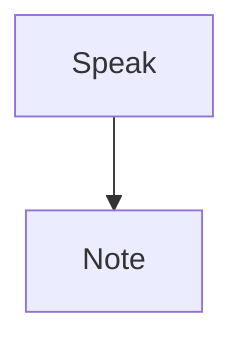

# Markdown and the Ghost.md marks
A note is words with a few marks around them. Type a mark and Ghost.md draws what it means, as you type. The characters stay in the file, so any other Markdown app reads the same thing.

Ghost.md reads standard Markdown first. On top of that it adds a few marks of its own, from the Marks plugin.

## Around words

Type the mark on both sides of the words.

- `**Friday at noon**` reads as **Friday at noon**
- `_if the weather holds_` reads as _if the weather holds_
- `***not*** refundable` reads as ***not*** refundable
- `~~on Thursday~~` reads as ~~on Thursday~~
- `` `npm run dev` `` reads as `npm run dev`
- `the 2^nd^ of June` reads as the 2^nd^ of June
- `H~2~O` reads as H~2~O
- `shipped :tada:` reads as shipped :tada:

`*one star*` works for italic too. A backslash makes a mark mean itself: `\*not italic\*` keeps its stars.

An emoji name between colons, spelled the way GitHub spells it, becomes its emoji. The name comes back while the caret is on its line. A name Ghost.md doesn't know stays as you typed it.

## At the start of a line

| Type | What it is |
|---|---|
| `# Weekend trip` | A title. `##` and on to `######` make smaller headings. |
| `- Oat milk` | A list. Enter starts the next item. |
| `1. Unplug it` | Steps in order |
| `- [ ] Book the cabin` | A to-do, ticked with a tap |
| `> The deposit comes back.` | A quote |
| `> [!NOTE]` | A callout, on the first line of a quote |
| `---` | A line across the page |

A callout is a quote set apart as a box. Its kind goes on its first line: `NOTE`, `TIP`, `IMPORTANT`, `WARNING` or `CAUTION`. The last two are drawn a shade stronger.

```
> [!TIP]
> Pack the coffee the night before.
```

Only `#` makes a heading. A line of dashes under a paragraph is always a dividing line, never a heading.

## Blocks

**Code.** Three backticks above and below some lines keep them exactly as typed. Name the language after the first three and the code is coloured for it. Ghost.md knows over a hundred languages.

````
```js
const note = "hello";
```
````

**Tables.** Pipes between the cells, and a row of dashes under the first row. See [[Boards, tables and live queries]].

**Diagrams.** A code block marked `mermaid` is drawn as the diagram it describes. Tap it to change its words. It's drawn on the device, so it works offline.

````

````

**Maths.** A dollar sign on each side, `$\pi r^2$`, is drawn as a formula. Two on each side, alone on a line, set it on its own in the middle. With the caret on the line you see what you typed. A formula Ghost.md can't read stays as code, with a dotted line under it.

**Definitions.** A term on one line, and its meaning on the next after a colon and a space:

```
Deposit
: what you pay up front
```

**Front matter.** `key: value` lines between two `---` lines at the very top of a note. Ghost.md folds them out of the way. Tickets, notebooks and journals keep their settings here.

## Ghost.md's own marks

These come from the **Marks** plugin. It's on unless you remove it in the Market.

| Mark | Type | Looks like |
|---|---|---|
| Spoiler | `\|\|the butler did it\|\|` | Blurred until the caret is in it |
| Highlight | `==the north gate==` | A wash of colour behind the words |
| Aside | `%%or the one after%%` | Smaller, quieter, leaning |
| Unsure | `??four hundred??` | A dotted line under a fact to check |
| Redact | `@@Sam Ortiz@@` | A solid bar of ink |
| Shout | `^^the tickets^^` | Spaced small capitals |
| Added | `++ten++` | A line under what was added |

Here they are at work: ||the butler did it||, ==the north gate==, %%or the one after%%, ??four hundred??, @@Sam Ortiz@@, ^^the tickets^^ and ++ten++.

**Highlight colours.** Put a colour's name in brackets straight after a highlight: `==the cabin key==(green)`. The colours are blue, red, amber, green, teal, purple and gray. Blue is the default.

**A note on a mark.** Words in brackets straight after one of these marks are a note on it: `??four hundred??(Sam said 400)`. The brackets are hidden, and tapping the words shows the note.

**A redaction is a look, not a lock.** The bar lifts while the caret is in the words, so you can read and edit them. The words are still in the file, and a share or an export has them. Use it for a name you'd rather not have on screen, not for a secret.

## Effects

Five marks that move. Each is its emoji twice on either side.

| Effect | Type | What it does |
|---|---|---|
| Heat | `🔥🔥too hot to touch🔥🔥` | Bold, and the line above wavers in the heat |
| Frost | `❄️❄️frozen solid❄️❄️` | A rime creeps over the words |
| Wave | `🌊🌊out to sea🌊🌊` | The words bob along the line |
| Shimmer | `✨✨silver thread✨✨` | A glint slides across every few seconds |
| Haunt | `👻👻nobody there👻👻` | The words fade almost away and back |

One emoji is just an emoji. An effect stops while the caret is in its words, so you edit plain text. When your device is set to reduce motion, effects hold still.

## Without typing a mark

- **Press and hold** some words (right-click on a Mac) and choose **Style**. You get **Bold**, **Italic**, **Struck** and **Code**, then Ghost.md's own marks, then what a line can be (**Heading**, **Quote**, **List**, **Numbered**, **To-do**), then **Link**, **Table** and **Rule**.
- **The + beside an empty line** puts in headings, lists, quotes, callouts, code, a divider, a diagram, a formula and each effect. In Simple, most of these are under **More**.
- **In Simple,** the format bar over the keyboard has the common ones.

## Two views

- **Markdown** shows the words formatted with the marks still on the page, dimmed.
- **Formatted** hides the marks, except on the line you're editing.

Switch with the first round button in a note's tools, or **Show the marks** and **Show the formatted note** in its More sheet.

## Every mark on one page

The cheat sheet, in Settings › About, has every mark with an example. **Ghost.md Academy** teaches them one at a time. The formatting reference at ghostmarkdown.com has them all too, with examples to copy.

See also: [[Links, tags and footnotes]], [[Lists, to-dos and tickets]], [[Speaking your notes]], [[The Market]]
